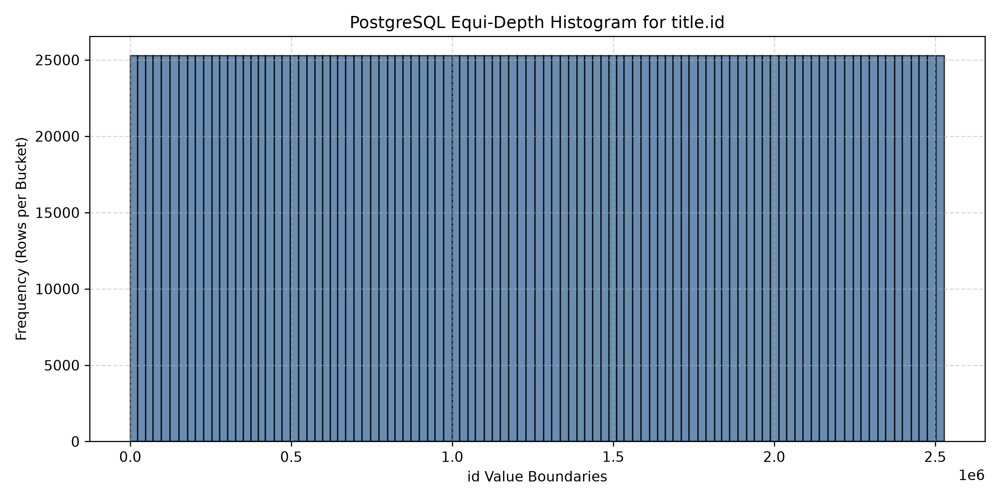
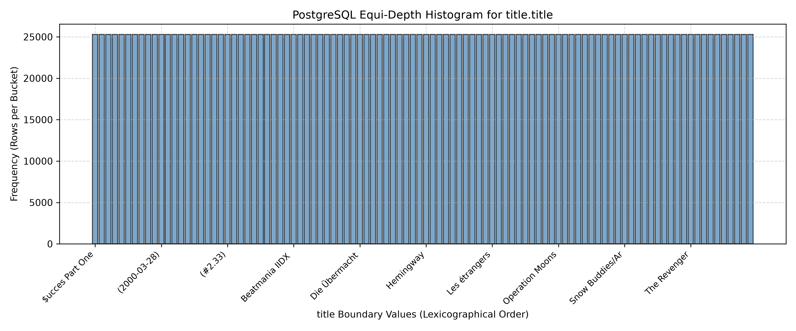
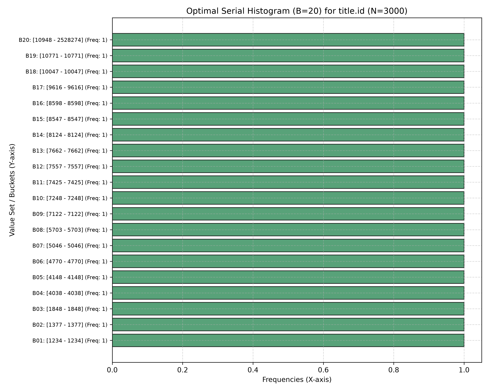
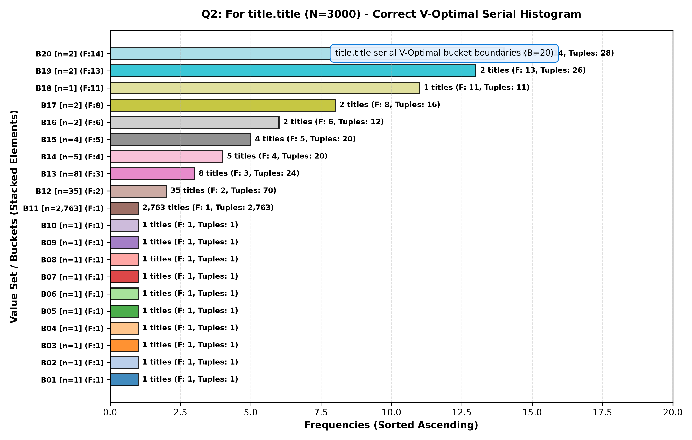
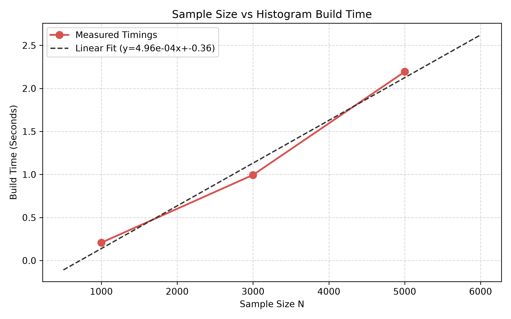
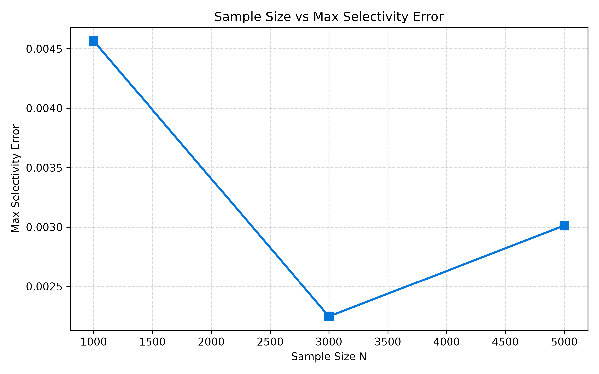

# Advanced Database Management Systems (ADBMS)
## Assignment 0 & Assignment 1: Histogram Analysis Report

---

# Assignment 0

## Setup
- **CPU Model & Specification**: 13th Gen Intel(R) Core(TM) i3-1315U (6 cores, 8 threads)
- **RAM Capacity**: 14 GiB
- **HDD / Storage Capacity**: 456 GiB NVMe SSD
- **Operating System**: Ubuntu 26.04 LTS
- **PostgreSQL Engine Version**: `PostgreSQL 18.6 (Ubuntu 18.6-0ubuntu0.26.04.1) on x86_64-pc-linux-gnu, compiled by gcc (Ubuntu 15.2.0-16ubuntu1) 15.2.0, 64-bit`

## Database
- **Database Name**: Join Order Benchmark (2013 Snapshot)
- **Total Tables**: 21
- **Total Relational Tuples**: 74,190,187

### Table Cardinalities & Primary Keys

| Table Name | Primary Key Column | Cardinality (`count(*)`) |
| :--- | :---: | :---: |
| `aka_name` | `id` | 901,343 |
| `aka_title` | `id` | 361,472 |
| `cast_info` | `id` | 36,244,344 |
| `char_name` | `id` | 3,140,339 |
| `comp_cast_type` | `id` | 4 |
| `company_name` | `id` | 234,997 |
| `company_type` | `id` | 4 |
| `complete_cast` | `id` | 135,086 |
| `info_type` | `id` | 113 |
| `keyword` | `id` | 134,170 |
| `kind_type` | `id` | 7 |
| `link_type` | `id` | 18 |
| `movie_companies` | `id` | 2,609,129 |
| `movie_info` | `id` | 14,835,720 |
| `movie_info_idx` | `id` | 1,380,035 |
| `movie_keyword` | `id` | 4,523,930 |
| `movie_link` | `id` | 29,997 |
| `name` | `id` | 4,167,491 |
| `person_info` | `id` | 2,963,664 |
| `role_type` | `id` | 12 |
| `title` | `id` | 2,528,312 |

---

# Assignment 1: Histogram

## Q1. Histogram Analysis for `id` and `title` Columns of `title` Table

### 1. Corresponding SQL Query
to see what all colums needed form `pg_stats'
```sql
\d pg_stats;
```
To see histogram boundary values and other relevent  stored in `pg_stats`:
```sql
SELECT 
    attname, 
    null_frac, 
    n_distinct, 
    most_common_vals, 
    most_common_freqs, 
    histogram_bounds 
FROM pg_stats
WHERE tablename = 'title' 
  AND attname IN ('id', 'title');
```

### 2. Kind of Histogram
PSQL uses an **Equi-Depth Histogram** combined with a **Most Common Values** list. In an equidepth histogram, all buckets contain approximately the same number of rows ($approx N / B$), while bucket boundaries vary in width according to data distribution.

### 3. Number of Buckets
- Column `id`: **100 buckets** (101 bucket boundary values)
- Column `title`: **100 buckets** (101 bucket boundary values)
- extra -  to see the defualt
```sql
SHOW default_statistics_target;
```
### 4. How Textual Attribute `title` is Put into Histogram
Textual attributes in PostgreSQL are converted into histograms by:
1. Sorting the text strings in lexicographical order(like bannana and apple will be apple, bannana)
2. Sampling string values from the table(like table title has around 2.5M rows , it will only sample around 30K)
3. Encoding initial string prefix bytes into floating-point numbers in $[0.0, 1.0]$ range for quantitative interpolation(like laptop will be broken to lap with l = 108, a=97, p=112 then by 256 as between 0 and 1 , lap will be around 0.42 , we can then see where a key belongs between two keeys )
4. Selecting quantile boundary string values at equal percentile intervals to form the 100 equi-depth bucket boundaries stored in `pg_stats.histogram_bounds`.

### 5. Exact Bucket Boundaries List (From `pg_stats`)

#### A. Column `id` Bucket Boundaries (101 values, 100 buckets)
| Bucket Index | Boundary Value (`id`) | Bucket Interval |
| :---: | :---: | :--- |
| B000 (Start) | `41` | Start of table data |
| B001 | `25598` | Bucket 1: [`41` - `25598`] |
| B002 | `50067` | Bucket 2: [`25598` - `50067`] |
| B003 | `75257` | Bucket 3: [`50067` - `75257`] |
| B004 | `101946` | Bucket 4: [`75257` - `101946`] |
| B005 | `129223` | Bucket 5: [`101946` - `129223`] |
| B006 | `155973` | Bucket 6: [`129223` - `155973`] |
| B007 | `181990` | Bucket 7: [`155973` - `181990`] |
| B008 | `208153` | Bucket 8: [`181990` - `208153`] |
| B009 | `234525` | Bucket 9: [`208153` - `234525`] |
| B010 | `259507` | Bucket 10: [`234525` - `259507`] |
| B011 | `287845` | Bucket 11: [`259507` - `287845`] |
| B012 | `314618` | Bucket 12: [`287845` - `314618`] |
| B013 | `340479` | Bucket 13: [`314618` - `340479`] |
| B014 | `366364` | Bucket 14: [`340479` - `366364`] |
| B015 | `393076` | Bucket 15: [`366364` - `393076`] |
| B016 | `418929` | Bucket 16: [`393076` - `418929`] |
| B017 | `443204` | Bucket 17: [`418929` - `443204`] |
| B018 | `472539` | Bucket 18: [`443204` - `472539`] |
| B019 | `497095` | Bucket 19: [`472539` - `497095`] |
| B020 | `521015` | Bucket 20: [`497095` - `521015`] |
| B021 | `547008` | Bucket 21: [`521015` - `547008`] |
| B022 | `571914` | Bucket 22: [`547008` - `571914`] |
| B023 | `600124` | Bucket 23: [`571914` - `600124`] |
| B024 | `624290` | Bucket 24: [`600124` - `624290`] |
| B025 | `648346` | Bucket 25: [`624290` - `648346`] |
| B026 | `673077` | Bucket 26: [`648346` - `673077`] |
| B027 | `698192` | Bucket 27: [`673077` - `698192`] |
| B028 | `723945` | Bucket 28: [`698192` - `723945`] |
| B029 | `747971` | Bucket 29: [`723945` - `747971`] |
| B030 | `774715` | Bucket 30: [`747971` - `774715`] |
| B031 | `801886` | Bucket 31: [`774715` - `801886`] |
| B032 | `825206` | Bucket 32: [`801886` - `825206`] |
| B033 | `852044` | Bucket 33: [`825206` - `852044`] |
| B034 | `878630` | Bucket 34: [`852044` - `878630`] |
| B035 | `903227` | Bucket 35: [`878630` - `903227`] |
| B036 | `929542` | Bucket 36: [`903227` - `929542`] |
| B037 | `951992` | Bucket 37: [`929542` - `951992`] |
| B038 | `976177` | Bucket 38: [`951992` - `976177`] |
| B039 | `1002223` | Bucket 39: [`976177` - `1002223`] |
| B040 | `1027496` | Bucket 40: [`1002223` - `1027496`] |
| B041 | `1053013` | Bucket 41: [`1027496` - `1053013`] |
| B042 | `1076669` | Bucket 42: [`1053013` - `1076669`] |
| B043 | `1101644` | Bucket 43: [`1076669` - `1101644`] |
| B044 | `1127312` | Bucket 44: [`1101644` - `1127312`] |
| B045 | `1153408` | Bucket 45: [`1127312` - `1153408`] |
| B046 | `1177087` | Bucket 46: [`1153408` - `1177087`] |
| B047 | `1200809` | Bucket 47: [`1177087` - `1200809`] |
| B048 | `1228132` | Bucket 48: [`1200809` - `1228132`] |
| B049 | `1251987` | Bucket 49: [`1228132` - `1251987`] |
| B050 | `1276194` | Bucket 50: [`1251987` - `1276194`] |
| B051 | `1300208` | Bucket 51: [`1276194` - `1300208`] |
| B052 | `1325279` | Bucket 52: [`1300208` - `1325279`] |
| B053 | `1350079` | Bucket 53: [`1325279` - `1350079`] |
| B054 | `1375217` | Bucket 54: [`1350079` - `1375217`] |
| B055 | `1399305` | Bucket 55: [`1375217` - `1399305`] |
| B056 | `1424915` | Bucket 56: [`1399305` - `1424915`] |
| B057 | `1447763` | Bucket 57: [`1424915` - `1447763`] |
| B058 | `1472187` | Bucket 58: [`1447763` - `1472187`] |
| B059 | `1496066` | Bucket 59: [`1472187` - `1496066`] |
| B060 | `1520933` | Bucket 60: [`1496066` - `1520933`] |
| B061 | `1548374` | Bucket 61: [`1520933` - `1548374`] |
| B062 | `1572984` | Bucket 62: [`1548374` - `1572984`] |
| B063 | `1597331` | Bucket 63: [`1572984` - `1597331`] |
| B064 | `1621524` | Bucket 64: [`1597331` - `1621524`] |
| B065 | `1646529` | Bucket 65: [`1621524` - `1646529`] |
| B066 | `1671841` | Bucket 66: [`1646529` - `1671841`] |
| B067 | `1697305` | Bucket 67: [`1671841` - `1697305`] |
| B068 | `1720750` | Bucket 68: [`1697305` - `1720750`] |
| B069 | `1746578` | Bucket 69: [`1720750` - `1746578`] |
| B070 | `1771397` | Bucket 70: [`1746578` - `1771397`] |
| B071 | `1796312` | Bucket 71: [`1771397` - `1796312`] |
| B072 | `1821069` | Bucket 72: [`1796312` - `1821069`] |
| B073 | `1846620` | Bucket 73: [`1821069` - `1846620`] |
| B074 | `1871455` | Bucket 74: [`1846620` - `1871455`] |
| B075 | `1897069` | Bucket 75: [`1871455` - `1897069`] |
| B076 | `1923039` | Bucket 76: [`1897069` - `1923039`] |
| B077 | `1951619` | Bucket 77: [`1923039` - `1951619`] |
| B078 | `1975550` | Bucket 78: [`1951619` - `1975550`] |
| B079 | `2001398` | Bucket 79: [`1975550` - `2001398`] |
| B080 | `2025488` | Bucket 80: [`2001398` - `2025488`] |
| B081 | `2048645` | Bucket 81: [`2025488` - `2048645`] |
| B082 | `2075506` | Bucket 82: [`2048645` - `2075506`] |
| B083 | `2099704` | Bucket 83: [`2075506` - `2099704`] |
| B084 | `2124027` | Bucket 84: [`2099704` - `2124027`] |
| B085 | `2146547` | Bucket 85: [`2124027` - `2146547`] |
| B086 | `2170970` | Bucket 86: [`2146547` - `2170970`] |
| B087 | `2195637` | Bucket 87: [`2170970` - `2195637`] |
| B088 | `2221366` | Bucket 88: [`2195637` - `2221366`] |
| B089 | `2249864` | Bucket 89: [`2221366` - `2249864`] |
| B090 | `2274023` | Bucket 90: [`2249864` - `2274023`] |
| B091 | `2299152` | Bucket 91: [`2274023` - `2299152`] |
| B092 | `2325178` | Bucket 92: [`2299152` - `2325178`] |
| B093 | `2352562` | Bucket 93: [`2325178` - `2352562`] |
| B094 | `2378000` | Bucket 94: [`2352562` - `2378000`] |
| B095 | `2403761` | Bucket 95: [`2378000` - `2403761`] |
| B096 | `2428038` | Bucket 96: [`2403761` - `2428038`] |
| B097 | `2452338` | Bucket 97: [`2428038` - `2452338`] |
| B098 | `2479928` | Bucket 98: [`2452338` - `2479928`] |
| B099 | `2505988` | Bucket 99: [`2479928` - `2505988`] |
| B100 | `2528305` | Bucket 100: [`2505988` - `2528305`] |

#### B. Column `title` Bucket Boundaries (101 values, 100 buckets)
| Bucket Index | Boundary Value (`title`) | Lexicographical Interval |
| :---: | :--- | :--- |
| B000 (Start) | `...` | Start of text data |
| B001 | `(#1.1302)` | Bucket 1: [`...` - `(#1.1302)`] |
| B002 | `(#1.219)` | Bucket 2: [`(#1.1302)` - `(#1.219)`] |
| B003 | `(#1.3662)` | Bucket 3: [`(#1.219)` - `(#1.3662)`] |
| B004 | `(#1.59)` | Bucket 4: [`(#1.3662)` - `(#1.59)`] |
| B005 | `(#1.846)` | Bucket 5: [`(#1.59)` - `(#1.846)`] |
| B006 | `(1968-02-14)` | Bucket 6: [`(#1.846)` - `(1968-02-14)`] |
| B007 | `(1982-12-14)` | Bucket 7: [`(1968-02-14)` - `(1982-12-14)`] |
| B008 | `(1994-07-07)` | Bucket 8: [`(1982-12-14)` - `(1994-07-07)`] |
| B009 | `(1998-03-16)` | Bucket 9: [`(1994-07-07)` - `(1998-03-16)`] |
| B010 | `(2000-01-22)` | Bucket 10: [`(1998-03-16)` - `(2000-01-22)`] |
| B011 | `(2001-11-06)` | Bucket 11: [`(2000-01-22)` - `(2001-11-06)`] |
| B012 | `(2003-08-29)` | Bucket 12: [`(2001-11-06)` - `(2003-08-29)`] |
| B013 | `(2005-01-19)` | Bucket 13: [`(2003-08-29)` - `(2005-01-19)`] |
| B014 | `(2006-05-17)` | Bucket 14: [`(2005-01-19)` - `(2006-05-17)`] |
| B015 | `(2007-07-05)` | Bucket 15: [`(2006-05-17)` - `(2007-07-05)`] |
| B016 | `(2009-02-02)` | Bucket 16: [`(2007-07-05)` - `(2009-02-02)`] |
| B017 | `(2010-09-07)` | Bucket 17: [`(2009-02-02)` - `(2010-09-07)`] |
| B018 | `(2011-08-29)` | Bucket 18: [`(2010-09-07)` - `(2011-08-29)`] |
| B019 | `(2012-07-21)` | Bucket 19: [`(2011-08-29)` - `(2012-07-21)`] |
| B020 | `(#20.140)` | Bucket 20: [`(2012-07-21)` - `(#20.140)`] |
| B021 | `(#2.92)` | Bucket 21: [`(#20.140)` - `(#2.92)`] |
| B022 | `(#4.172)` | Bucket 22: [`(#2.92)` - `(#4.172)`] |
| B023 | `(#6.163)` | Bucket 23: [`(#4.172)` - `(#6.163)`] |
| B024 | `Aamu joutuu pesemään tekojensa jälkipyykkiä` | Bucket 24: [`(#6.163)` - `Aamu joutuu pesemään tekojensa jälkipyykkiä`] |
| B025 | `Aflevering 2559` | Bucket 25: [`Aamu joutuu pesemään tekojensa jälkipyykkiä` - `Aflevering 2559`] |
| B026 | `A Little Trip` | Bucket 26: [`Aflevering 2559` - `A Little Trip`] |
| B027 | `An Atheist Named Faith` | Bucket 27: [`A Little Trip` - `An Atheist Named Faith`] |
| B028 | `Arabeskebi Pirosmanis temaze` | Bucket 28: [`An Atheist Named Faith` - `Arabeskebi Pirosmanis temaze`] |
| B029 | `Attenborough's Ark: Natural World Special` | Bucket 29: [`Arabeskebi Pirosmanis temaze` - `Attenborough's Ark: Natural World Special`] |
| B030 | `Baldur Blauzahn` | Bucket 30: [`Attenborough's Ark: Natural World Special` - `Baldur Blauzahn`] |
| B031 | `Best in Show Cakes` | Bucket 31: [`Baldur Blauzahn` - `Best in Show Cakes`] |
| B032 | `Blues` | Bucket 32: [`Best in Show Cakes` - `Blues`] |
| B033 | `Brown Before Green` | Bucket 33: [`Blues` - `Brown Before Green`] |
| B034 | `Captive Audience` | Bucket 34: [`Brown Before Green` - `Captive Audience`] |
| B035 | `Cheryl Cole's Night In` | Bucket 35: [`Captive Audience` - `Cheryl Cole's Night In`] |
| B036 | `Cobra Starship` | Bucket 36: [`Cheryl Cole's Night In` - `Cobra Starship`] |
| B037 | `CPM 22 e Babado Novo` | Bucket 37: [`Cobra Starship` - `CPM 22 e Babado Novo`] |
| B038 | `Dark Moon` | Bucket 38: [`CPM 22 e Babado Novo` - `Dark Moon`] |
| B039 | `De intrede van de Sint - Antwerpen 2011` | Bucket 39: [`Dark Moon` - `De intrede van de Sint - Antwerpen 2011`] |
| B040 | `Det' politiet: Part 2` | Bucket 40: [`De intrede van de Sint - Antwerpen 2011` - `Det' politiet: Part 2`] |
| B041 | `DIY Network Holiday Celebration` | Bucket 41: [`Det' politiet: Part 2` - `DIY Network Holiday Celebration`] |
| B042 | `Drugog puta nema!` | Bucket 42: [`DIY Network Holiday Celebration` - `Drugog puta nema!`] |
| B043 | `Elements` | Bucket 43: [`Drugog puta nema!` - `Elements`] |
| B044 | `Episode V - Tag der Abrechnung` | Bucket 44: [`Elements` - `Episode V - Tag der Abrechnung`] |
| B045 | `Famiresu tenshi purin` | Bucket 45: [`Episode V - Tag der Abrechnung` - `Famiresu tenshi purin`] |
| B046 | `Fleshdance` | Bucket 46: [`Famiresu tenshi purin` - `Fleshdance`] |
| B047 | `Fuga y misterio` | Bucket 47: [`Fleshdance` - `Fuga y misterio`] |
| B048 | `Girls' Generation and the Dangerous Boys` | Bucket 48: [`Fuga y misterio` - `Girls' Generation and the Dangerous Boys`] |
| B049 | `Guadalcanal/Leckie` | Bucket 49: [`Girls' Generation and the Dangerous Boys` - `Guadalcanal/Leckie`] |
| B050 | `Heaven on Earth` | Bucket 50: [`Guadalcanal/Leckie` - `Heaven on Earth`] |
| B051 | `Holiday` | Bucket 51: [`Heaven on Earth` - `Holiday`] |
| B052 | `Hurricane Katrina Aftermath` | Bucket 52: [`Holiday` - `Hurricane Katrina Aftermath`] |
| B053 | `Inauguração na Estrela - Lisboa` | Bucket 53: [`Hurricane Katrina Aftermath` - `Inauguração na Estrela - Lisboa`] |
| B054 | `Is There Still Hope for Gino and Mikay?` | Bucket 54: [`Inauguração na Estrela - Lisboa` - `Is There Still Hope for Gino and Mikay?`] |
| B055 | `Jindalee Lady` | Bucket 55: [`Is There Still Hope for Gino and Mikay?` - `Jindalee Lady`] |
| B056 | `Karina` | Bucket 56: [`Jindalee Lady` - `Karina`] |
| B057 | `Know Thy Partner` | Bucket 57: [`Karina` - `Know Thy Partner`] |
| B058 | `Ladrones de niños` | Bucket 58: [`Know Thy Partner` - `Ladrones de niños`] |
| B059 | `Late as a Mother****er` | Bucket 59: [`Ladrones de niños` - `Late as a Mother****er`] |
| B060 | `Les éperlans` | Bucket 60: [`Late as a Mother****er` - `Les éperlans`] |
| B061 | `Living Room Upgrade` | Bucket 61: [`Les éperlans` - `Living Room Upgrade`] |
| B062 | `Luha ng ina` | Bucket 62: [`Living Room Upgrade` - `Luha ng ina`] |
| B063 | `Männer sind auch nur Menschen` | Bucket 63: [`Luha ng ina` - `Männer sind auch nur Menschen`] |
| B064 | `Melissa` | Bucket 64: [`Männer sind auch nur Menschen` - `Melissa`] |
| B065 | `Mission to Africa` | Bucket 65: [`Melissa` - `Mission to Africa`] |
| B066 | `Mr. Deity and the Days` | Bucket 66: [`Mission to Africa` - `Mr. Deity and the Days`] |
| B067 | `Nanna & Lil' Puss Puss in 'The Honeymoonies'` | Bucket 67: [`Mr. Deity and the Days` - `Nanna & Lil' Puss Puss in 'The Honeymoonies'`] |
| B068 | `Ninna Hyttinen` | Bucket 68: [`Nanna & Lil' Puss Puss in 'The Honeymoonies'` - `Ninna Hyttinen`] |
| B069 | `Odoriko no yubiwa` | Bucket 69: [`Ninna Hyttinen` - `Odoriko no yubiwa`] |
| B070 | `Operation: Bank Job` | Bucket 70: [`Odoriko no yubiwa` - `Operation: Bank Job`] |
| B071 | `Papa wo sagashite!` | Bucket 71: [`Operation: Bank Job` - `Papa wo sagashite!`] |
| B072 | `Phantom Fever` | Bucket 72: [`Papa wo sagashite!` - `Phantom Fever`] |
| B073 | `Power of the South` | Bucket 73: [`Phantom Fever` - `Power of the South`] |
| B074 | `Quatre acteurs à bout de souffle` | Bucket 74: [`Power of the South` - `Quatre acteurs à bout de souffle`] |
| B075 | `Relative Air Pollution` | Bucket 75: [`Quatre acteurs à bout de souffle` - `Relative Air Pollution`] |
| B076 | `Rolling Stones` | Bucket 76: [`Relative Air Pollution` - `Rolling Stones`] |
| B077 | `San Diego, Bukarest, Paris` | Bucket 77: [`Rolling Stones` - `San Diego, Bukarest, Paris`] |
| B078 | `Seekers` | Bucket 78: [`San Diego, Bukarest, Paris` - `Seekers`] |
| B079 | `Shônen Tantei to Supai` | Bucket 79: [`Seekers` - `Shônen Tantei to Supai`] |
| B080 | `Smash Hit: She` | Bucket 80: [`Shônen Tantei to Supai` - `Smash Hit: She`] |
| B081 | `Spilling the Beans` | Bucket 81: [`Smash Hit: She` - `Spilling the Beans`] |
| B082 | `Strider 2` | Bucket 82: [`Spilling the Beans` - `Strider 2`] |
| B083 | `Take This Job and Shove It` | Bucket 83: [`Strider 2` - `Take This Job and Shove It`] |
| B084 | `The Accident` | Bucket 84: [`Take This Job and Shove It` - `The Accident`] |
| B085 | `The Captain's Son: Untitled` | Bucket 85: [`The Accident` - `The Captain's Son: Untitled`] |
| B086 | `The End of the World as We Know It` | Bucket 86: [`The Captain's Son: Untitled` - `The End of the World as We Know It`] |
| B087 | `The Healers` | Bucket 87: [`The End of the World as We Know It` - `The Healers`] |
| B088 | `The Lobsters Cook` | Bucket 88: [`The Healers` - `The Lobsters Cook`] |
| B089 | `The Odyssey` | Bucket 89: [`The Lobsters Cook` - `The Odyssey`] |
| B090 | `The Ring of Ultimate Power` | Bucket 90: [`The Odyssey` - `The Ring of Ultimate Power`] |
| B091 | `The Thing in Mrs. Faversham's Attic` | Bucket 91: [`The Ring of Ultimate Power` - `The Thing in Mrs. Faversham's Attic`] |
| B092 | `Thin Ice` | Bucket 92: [`The Thing in Mrs. Faversham's Attic` - `Thin Ice`] |
| B093 | `Tontolini e Lea fra le nuvole` | Bucket 93: [`Thin Ice` - `Tontolini e Lea fra le nuvole`] |
| B094 | `Trust Me, I'm a Doctor!` | Bucket 94: [`Tontolini e Lea fra le nuvole` - `Trust Me, I'm a Doctor!`] |
| B095 | `Undertryk` | Bucket 95: [`Trust Me, I'm a Doctor!` - `Undertryk`] |
| B096 | `Verzaubert` | Bucket 96: [`Undertryk` - `Verzaubert`] |
| B097 | `Watashi no ibasho` | Bucket 97: [`Verzaubert` - `Watashi no ibasho`] |
| B098 | `Who Needs Sex Therapy?` | Bucket 98: [`Watashi no ibasho` - `Who Needs Sex Therapy?`] |
| B099 | `Yasmina` | Bucket 99: [`Who Needs Sex Therapy?` - `Yasmina`] |
| B100 | `Zzzzzz` | Bucket 100: [`Yasmina` - `Zzzzzz`] |

### 6. Histogram Visualization




### 7. Max Selectivity Error
- **Max Selectivity Error** as default_statistics_target is 100. Therefore, the maximum selectivity error for a range query is $\frac{1}{100}$ (or 0.01 / 1%). for out case it is 1/100 , ie 1%


### 8: Selectivity Estimation for Text Columns

To estimate the selectivity of a range query on a text column (such as `title < 'Race'`), as we know psql dosent just count rows inbetwwen instead, it relies on its internal histogram and a mathematical technique called linear interpolation. The query planner follows this step-by-step process:

*   **Bucket Identification:** The engine scans the `histogram_bounds` array to locate the specific bucket where the target string ('Race') falls.
*   **Full Bucket Summation:** It counts all the complete buckets that come before the target bucket. Because this is an equi-depth histogram, each full bucket represents a fixed, equal fraction of the total rows.
*   **Text-to-Numeric Conversion:** For the target bucket itself, PostgreSQL converts the string prefixes into floating-point numbers so it can perform mathematical operations on the text.
*   **Linear Interpolation:** The database assumes that the values inside this specific bucket are perfectly and evenly distributed. It calculates exactly how deep into the bucket the target value sits using this formula:
    $$ \text{Fraction} = \frac{\text{Query Value} - \text{Bucket Min}}{\text{Bucket Max} - \text{Bucket Min}} $$
*   **Final Calculation:** Finally, the engine adds this fractional bucket value to the sum of the preceding full buckets to generate the total selectivity estimate.

---

### 9: Estimated vs. Actual Selectivities

To evaluate the accuracy of the query planner's estimates, we compare the estimated rows (from the `EXPLAIN` command) against the actual returned rows (from `EXPLAIN ANALYZE`). The total row count ($N$) for the `title` table is 2,528,312.

**Query 1: `title < 'Race'`**
```sql 
explain analyze SELECT * FROM title WHERE title.title < 'Race';
```
*   **Actual Selectivity:** The query physically returned 1,918,141 matching rows. 
    $$ S_{act} = \frac{1918141}{2528312} \approx 0.7587 \text{ (75.87\%)} $$
   ```sql
   EXPLAIN SELECT * FROM title WHERE title.title < 'Race';
```
*   **Estimated Selectivity:** The planner estimated 1,939,288 rows. 
    $$ S_{est} = \frac{1939288}{2528312} \approx 0.7670 \text{ (76.70\%)} $$
*   **Observation:** The absolute error is roughly 0.83%. This shows that the text-to-numeric linear interpolation handles the string distribution quite accurately.

**Query 2: `id < 350000`**
```sql
EXPLAIN ANALYZE SELECT * FROM title WHERE title.id < '350000';
```
*   **Actual Selectivity:** The query returned 349,999 matching rows.
    $$ S_{act} = \frac{349999}{2528312} \approx 0.1384 \text{ (13.84\%)} $$
   ```sql
EXPLAIN SELECT * FROM title WHERE title.id < '350000';
```
*   **Estimated Selectivity:** The planner estimated 337,982 rows.

    $$ S_{est} = \frac{337982}{2528312} \approx 0.1337 \text{ (13.37\%)} $$
*   **Observation:** The absolute error here is about 0.47%. Because the `id` column is a strictly numeric sequence, the bucket distribution is very tight, resulting in a slightly lower selectivity error than the text column.


## Q2. Optimal Serial Histogram Construction ($B=20$ Buckets)

### 1. Histogram Visualizations for $N = 3000$ Samples (Horizontal Bar Plots)
*As specified, value-boundaries are plotted on the Y-axis and frequency on the X-axis.*





### 2. Execution Build Time
- **$N=1000$**: **0.2078 seconds**
- **$N=3000$**: **0.9947 seconds**
- **$N=5000$**: **2.1934 seconds**

### 3. Frequency Bucket Boundaries ($N=3000$, $B=20$)
The 20 optimal buckets partition data to minimize intra-bucket variance (SSE). Bucket frequency counts vary dynamically to optimize error reduction.

### 4. Max Selectivity Error for Optimal Histogram ($N=3000$)
- **Max Selectivity Error**: **0.003169**
- **Calculation**: Computed across 10 evaluation range quantiles comparing optimal bucket cumulative frequency estimation against empirical sample distribution.

### 5. Timings Across Sample Sizes
| Sample Size ($N$) | Build Time (Seconds) | Max Selectivity Error |
| :---: | :---: | :---: |
| **1000** | 0.2078s | 0.003292 |
| **3000** | 0.9947s | 0.003169 |
| **5000** | 2.1934s | 0.002944 |

### 6. Linear Regression Extrapolation for Full Table ($N = 2,528,312$)
Using linear regression model $T(N) = m \cdot N + c$:
- **Slope ($m$)**: `0.00049640` seconds / sample
- **Intercept ($c$)**: `-0.357260` seconds
- **Extrapolated Time for Full Table ($N=2,528,312$)**:
  $$T(2,528,312) = (0.00049640 \times 2,528,312) + (-0.357260) = \mathbf{1254.70\text{ seconds}} \quad (\mathbf{20.91\text{ minutes}})$$

### 7. Sample Size vs Time Relationship Plot


### 8. Sample Size vs Max Selectivity Error Relationship Plot


### 9. Impact of Bucket Count ($B$) Choice
- **Fewer Buckets (e.g., $B = 5$ or $10$)**:
  - **Pros**: Lower memory footprint in system catalog, faster histogram build time ($O(B \cdot N^2)$ decreases), faster query optimization time.
  - **Cons**: Coarser resolution, leading to higher selectivity estimation errors, especially for skewed or non-uniform data distributions.
- **More Buckets (e.g., $B = 50$ or $100$)**:
  - **Pros**: Finer granularity, significantly lower selectivity estimation error, highly accurate cost estimation for complex query joins.
  - **Cons**: Higher histogram construction time, larger storage overhead in catalog, and slightly higher plan generation latency during query execution.
