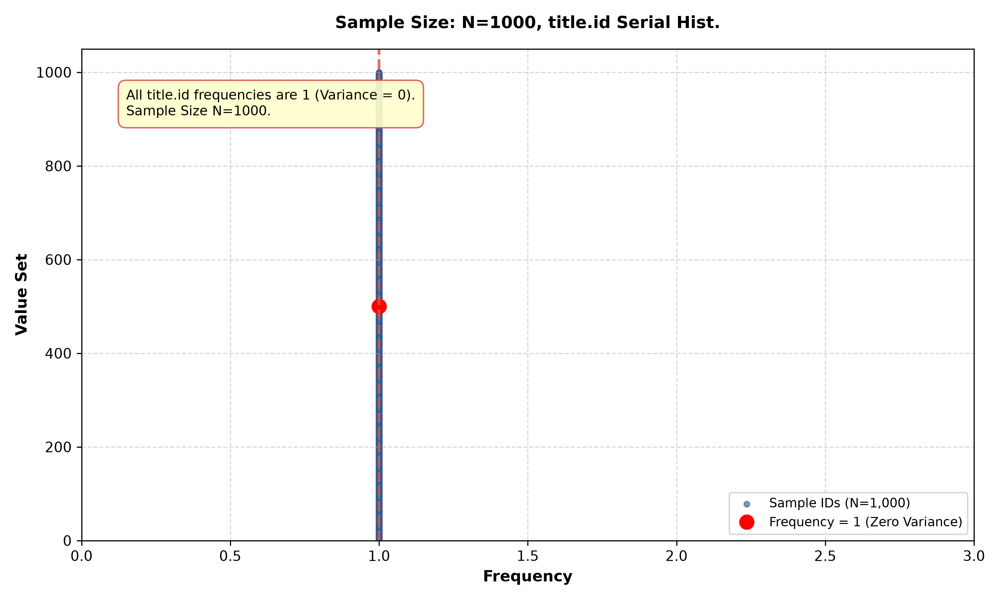
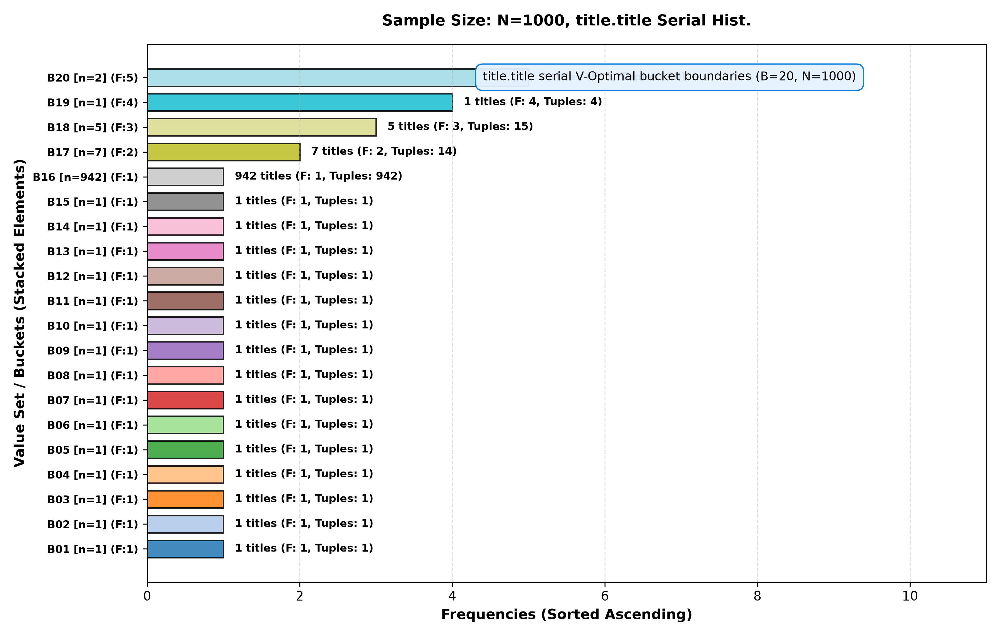
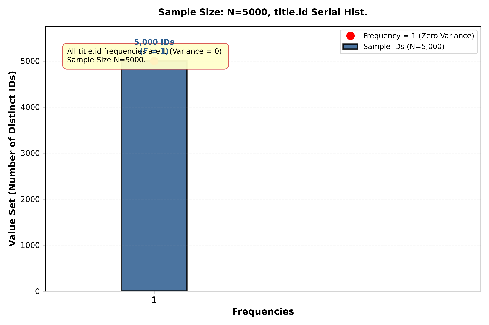
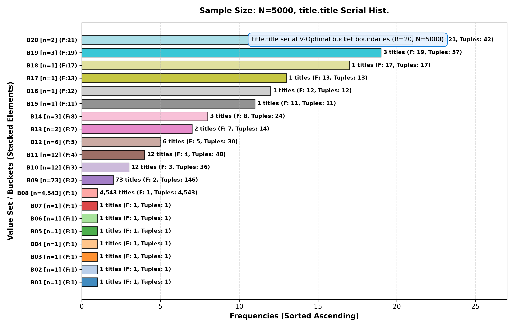

# Advanced Database Management Systems (ADBMS)
## Assignment 0 & Assignment 1: Histogram Analysis Report

---

# Assignment 0

## Setup
- **CPU Model & Specification**: 13th Gen Intel(R) Core(TM) i3-1315U (6 cores, 8 threads)
- **RAM Capacity**: 14 GiB
- **HDD / Storage Capacity**: 456 GiB NVMe SSD
- **Operating System**: Ubuntu 26.04 LTS
- **PostgreSQL Engine Version**: `PostgreSQL 18.6 (Ubuntu 18.6-0ubuntu0.26.04.1) on x86_64-pc-linux-gnu, compiled by gcc (Ubuntu 15.2.0-16ubuntu1) 15.2.0, 64-bit`

## Database
- **Database Name**: Join Order Benchmark (2013 Snapshot)
- **Total Tables**: 21
- **Total Relational Tuples**: 74,190,187

### Table Cardinalities & Primary Keys

| Table Name | Primary Key Column | Cardinality (`count(*)`) |
| :--- | :---: | :---: |
| `aka_name` | `id` | 901,343 |
| `aka_title` | `id` | 361,472 |
| `cast_info` | `id` | 36,244,344 |
| `char_name` | `id` | 3,140,339 |
| `comp_cast_type` | `id` | 4 |
| `company_name` | `id` | 234,997 |
| `company_type` | `id` | 4 |
| `complete_cast` | `id` | 135,086 |
| `info_type` | `id` | 113 |
| `keyword` | `id` | 134,170 |
| `kind_type` | `id` | 7 |
| `link_type` | `id` | 18 |
| `movie_companies` | `id` | 2,609,129 |
| `movie_info` | `id` | 14,835,720 |
| `movie_info_idx` | `id` | 1,380,035 |
| `movie_keyword` | `id` | 4,523,930 |
| `movie_link` | `id` | 29,997 |
| `name` | `id` | 4,167,491 |
| `person_info` | `id` | 2,963,664 |
| `role_type` | `id` | 12 |
| `title` | `id` | 2,528,312 |

---

# Assignment 1: Histogram

## Q1. Histogram Analysis for `id` and `title` Columns of `title` Table

### 1. Corresponding SQL Query
to see what all colums needed form `pg_stats'
```sql
\d pg_stats;
```
to see histogram boundary values and other relevent  stored in `pg_stats`:
```sql
SELECT 
    attname, 
    null_frac, 
    n_distinct, 
    most_common_vals, 
    most_common_freqs, 
    histogram_bounds 
FROM pg_stats
WHERE tablename = 'title' 
  AND attname IN ('id', 'title');
```

### 2. Kind of Histogram
PSQL uses an Equi Depth Histogram combined with a Most Common Values list. In an equidepth histogram, all buckets contain approximately the same number of rows ($approx N / B$), while bucket boundaries vary in width according to data distribution

### 3. Number of Buckets
- Column `id`: **100 buckets** (101 bucket boundary values)
- Column `title`: **100 buckets** (101 bucket boundary values)
- extra -  to see the defualt number of buckets
```sql
SHOW default_statistics_target;
```

### 4. How Textual Attribute `title` is Put into Histogram
textual attribute “title” is put into histogram as:
1. sorting the text strings in lexicographical order like bannana and apple will be apple, bannana after sorting
2. Sampling string values from the table like table title has around 2.5M rows , it will only sample around 30K
3. Encoding initial string prefix bytes into floating-point numbers in $[0.0, 1.0]$ range for quantitative interpolation like laptop will be broken to lap with l = 108, a=97, p=112 then by 256 as between 0 and 1 , lap will be around 0.42 , we can then see where a key belongs between two keeys 
4. Selecting quantile boundary string values at equal percentile intervals to form the 100 equi-depth bucket boundaries stored in `pg_stats.histogram_bounds`.

### 5. Exact Bucket Boundaries List (From `pg_stats`)

#### A. Column `id` Bucket Boundaries (101 values, 100 buckets)
| Bucket Index | Boundary Value (`id`) | Bucket Interval |
| :---: | :---: | :--- |
| B000 (Start) | `85` | Start of table data |
| B001 | `23414` | Bucket 1: [`85` - `23414`] |
| B002 | `50842` | Bucket 2: [`23414` - `50842`] |
| B003 | `72092` | Bucket 3: [`50842` - `72092`] |
| B004 | `95754` | Bucket 4: [`72092` - `95754`] |
| B005 | `120981` | Bucket 5: [`95754` - `120981`] |
| B006 | `146382` | Bucket 6: [`120981` - `146382`] |
| B007 | `169338` | Bucket 7: [`146382` - `169338`] |
| B008 | `193625` | Bucket 8: [`169338` - `193625`] |
| B009 | `222737` | Bucket 9: [`193625` - `222737`] |
| B010 | `248023` | Bucket 10: [`222737` - `248023`] |
| B011 | `273293` | Bucket 11: [`248023` - `273293`] |
| B012 | `297400` | Bucket 12: [`273293` - `297400`] |
| B013 | `321995` | Bucket 13: [`297400` - `321995`] |
| B014 | `348628` | Bucket 14: [`321995` - `348628`] |
| B015 | `372223` | Bucket 15: [`348628` - `372223`] |
| B016 | `399997` | Bucket 16: [`372223` - `399997`] |
| B017 | `425563` | Bucket 17: [`399997` - `425563`] |
| B018 | `452049` | Bucket 18: [`425563` - `452049`] |
| B019 | `477594` | Bucket 19: [`452049` - `477594`] |
| B020 | `503120` | Bucket 20: [`477594` - `503120`] |
| B021 | `527541` | Bucket 21: [`503120` - `527541`] |
| B022 | `550901` | Bucket 22: [`527541` - `550901`] |
| B023 | `578985` | Bucket 23: [`550901` - `578985`] |
| B024 | `602917` | Bucket 24: [`578985` - `602917`] |
| B025 | `629391` | Bucket 25: [`602917` - `629391`] |
| B026 | `655601` | Bucket 26: [`629391` - `655601`] |
| B027 | `681541` | Bucket 27: [`655601` - `681541`] |
| B028 | `705430` | Bucket 28: [`681541` - `705430`] |
| B029 | `729765` | Bucket 29: [`705430` - `729765`] |
| B030 | `756585` | Bucket 30: [`729765` - `756585`] |
| B031 | `784558` | Bucket 31: [`756585` - `784558`] |
| B032 | `810790` | Bucket 32: [`784558` - `810790`] |
| B033 | `836757` | Bucket 33: [`810790` - `836757`] |
| B034 | `861299` | Bucket 34: [`836757` - `861299`] |
| B035 | `887193` | Bucket 35: [`861299` - `887193`] |
| B036 | `911713` | Bucket 36: [`887193` - `911713`] |
| B037 | `936140` | Bucket 37: [`911713` - `936140`] |
| B038 | `964425` | Bucket 38: [`936140` - `964425`] |
| B039 | `990604` | Bucket 39: [`964425` - `990604`] |
| B040 | `1017549` | Bucket 40: [`990604` - `1017549`] |
| B041 | `1042518` | Bucket 41: [`1017549` - `1042518`] |
| B042 | `1068162` | Bucket 42: [`1042518` - `1068162`] |
| B043 | `1092644` | Bucket 43: [`1068162` - `1092644`] |
| B044 | `1119041` | Bucket 44: [`1092644` - `1119041`] |
| B045 | `1143249` | Bucket 45: [`1119041` - `1143249`] |
| B046 | `1167293` | Bucket 46: [`1143249` - `1167293`] |
| B047 | `1190899` | Bucket 47: [`1167293` - `1190899`] |
| B048 | `1214192` | Bucket 48: [`1190899` - `1214192`] |
| B049 | `1237126` | Bucket 49: [`1214192` - `1237126`] |
| B050 | `1259630` | Bucket 50: [`1237126` - `1259630`] |
| B051 | `1282683` | Bucket 51: [`1259630` - `1282683`] |
| B052 | `1307704` | Bucket 52: [`1282683` - `1307704`] |
| B053 | `1331946` | Bucket 53: [`1307704` - `1331946`] |
| B054 | `1354962` | Bucket 54: [`1331946` - `1354962`] |
| B055 | `1381303` | Bucket 55: [`1354962` - `1381303`] |
| B056 | `1406118` | Bucket 56: [`1381303` - `1406118`] |
| B057 | `1432716` | Bucket 57: [`1406118` - `1432716`] |
| B058 | `1460142` | Bucket 58: [`1432716` - `1460142`] |
| B059 | `1484816` | Bucket 59: [`1460142` - `1484816`] |
| B060 | `1512661` | Bucket 60: [`1484816` - `1512661`] |
| B061 | `1538548` | Bucket 61: [`1512661` - `1538548`] |
| B062 | `1562535` | Bucket 62: [`1538548` - `1562535`] |
| B063 | `1585840` | Bucket 63: [`1562535` - `1585840`] |
| B064 | `1611166` | Bucket 64: [`1585840` - `1611166`] |
| B065 | `1635920` | Bucket 65: [`1611166` - `1635920`] |
| B066 | `1662169` | Bucket 66: [`1635920` - `1662169`] |
| B067 | `1688003` | Bucket 67: [`1662169` - `1688003`] |
| B068 | `1714390` | Bucket 68: [`1688003` - `1714390`] |
| B069 | `1737794` | Bucket 69: [`1714390` - `1737794`] |
| B070 | `1762970` | Bucket 70: [`1737794` - `1762970`] |
| B071 | `1786873` | Bucket 71: [`1762970` - `1786873`] |
| B072 | `1813638` | Bucket 72: [`1786873` - `1813638`] |
| B073 | `1840890` | Bucket 73: [`1813638` - `1840890`] |
| B074 | `1867370` | Bucket 74: [`1840890` - `1867370`] |
| B075 | `1895175` | Bucket 75: [`1867370` - `1895175`] |
| B076 | `1919111` | Bucket 76: [`1895175` - `1919111`] |
| B077 | `1941477` | Bucket 77: [`1919111` - `1941477`] |
| B078 | `1966111` | Bucket 78: [`1941477` - `1966111`] |
| B079 | `1992282` | Bucket 79: [`1966111` - `1992282`] |
| B080 | `2016500` | Bucket 80: [`1992282` - `2016500`] |
| B081 | `2040965` | Bucket 81: [`2016500` - `2040965`] |
| B082 | `2067381` | Bucket 82: [`2040965` - `2067381`] |
| B083 | `2090687` | Bucket 83: [`2067381` - `2090687`] |
| B084 | `2116111` | Bucket 84: [`2090687` - `2116111`] |
| B085 | `2142228` | Bucket 85: [`2116111` - `2142228`] |
| B086 | `2167352` | Bucket 86: [`2142228` - `2167352`] |
| B087 | `2192781` | Bucket 87: [`2167352` - `2192781`] |
| B088 | `2217642` | Bucket 88: [`2192781` - `2217642`] |
| B089 | `2245252` | Bucket 89: [`2217642` - `2245252`] |
| B090 | `2268088` | Bucket 90: [`2245252` - `2268088`] |
| B091 | `2292543` | Bucket 91: [`2268088` - `2292543`] |
| B092 | `2318646` | Bucket 92: [`2292543` - `2318646`] |
| B093 | `2343571` | Bucket 93: [`2318646` - `2343571`] |
| B094 | `2369432` | Bucket 94: [`2343571` - `2369432`] |
| B095 | `2395899` | Bucket 95: [`2369432` - `2395899`] |
| B096 | `2422979` | Bucket 96: [`2395899` - `2422979`] |
| B097 | `2448577` | Bucket 97: [`2422979` - `2448577`] |
| B098 | `2475828` | Bucket 98: [`2448577` - `2475828`] |
| B099 | `2502132` | Bucket 99: [`2475828` - `2502132`] |
| B100 | `2528188` | Bucket 100: [`2502132` - `2528188`] |

#### B. Column `title` Bucket Boundaries (101 values, 100 buckets)
| Bucket Index | Boundary Value (`title`) | Lexicographical Interval |
| :---: | :--- | :--- |
| B000 (Start) | `\$100,000 Name That Tune` | Start of text data |
| B001 | `(#1.135)` | Bucket 1: [`\$100,000 Name That Tune` - `(#1.135)`] |
| B002 | `(#1.220)` | Bucket 2: [`(#1.135)` - `(#1.220)`] |
| B003 | `(#1.3630)` | Bucket 3: [`(#1.220)` - `(#1.3630)`] |
| B004 | `(#1.5551)` | Bucket 4: [`(#1.3630)` - `(#1.5551)`] |
| B005 | `(#1.7648)` | Bucket 5: [`(#1.5551)` - `(#1.7648)`] |
| B006 | `(1964-03-09)` | Bucket 6: [`(#1.7648)` - `(1964-03-09)`] |
| B007 | `(#1.981)` | Bucket 7: [`(1964-03-09)` - `(#1.981)`] |
| B008 | `(1993-01-27)` | Bucket 8: [`(#1.981)` - `(1993-01-27)`] |
| B009 | `(1997-10-20)` | Bucket 9: [`(1993-01-27)` - `(1997-10-20)`] |
| B010 | `(2000-01-31)` | Bucket 10: [`(1997-10-20)` - `(2000-01-31)`] |
| B011 | `(2001-10-04)` | Bucket 11: [`(2000-01-31)` - `(2001-10-04)`] |
| B012 | `(2003-08-05)` | Bucket 12: [`(2001-10-04)` - `(2003-08-05)`] |
| B013 | `(2004-11-24)` | Bucket 13: [`(2003-08-05)` - `(2004-11-24)`] |
| B014 | `(2006-03-14)` | Bucket 14: [`(2004-11-24)` - `(2006-03-14)`] |
| B015 | `(2007-06-22)` | Bucket 15: [`(2006-03-14)` - `(2007-06-22)`] |
| B016 | `(2009-01-06)` | Bucket 16: [`(2007-06-22)` - `(2009-01-06)`] |
| B017 | `(2010-10-09)` | Bucket 17: [`(2009-01-06)` - `(2010-10-09)`] |
| B018 | `(2011-10-31)` | Bucket 18: [`(2010-10-09)` - `(2011-10-31)`] |
| B019 | `(2012-11-08)` | Bucket 19: [`(2011-10-31)` - `(2012-11-08)`] |
| B020 | `(#2.24)` | Bucket 20: [`(2012-11-08)` - `(#2.24)`] |
| B021 | `(#3.252)` | Bucket 21: [`(#2.24)` - `(#3.252)`] |
| B022 | `(#5.14)` | Bucket 22: [`(#3.252)` - `(#5.14)`] |
| B023 | `(#7.48)` | Bucket 23: [`(#5.14)` - `(#7.48)`] |
| B024 | `According to Jim` | Bucket 24: [`(#7.48)` - `According to Jim`] |
| B025 | `A Girl's Affair 8` | Bucket 25: [`According to Jim` - `A Girl's Affair 8`] |
| B026 | `Älska mej` | Bucket 26: [`A Girl's Affair 8` - `Älska mej`] |
| B027 | `Animated Stories from the Bible: Music Video - Volume 1` | Bucket 27: [`Älska mej` - `Animated Stories from the Bible: Music Video - Volume 1`] |
| B028 | `As Férias` | Bucket 28: [`Animated Stories from the Bible: Music Video - Volume 1` - `As Férias`] |
| B029 | `A World Away: Stories from the Regina Five` | Bucket 29: [`As Férias` - `A World Away: Stories from the Regina Five`] |
| B030 | `Beautiful Girls 2` | Bucket 30: [`A World Away: Stories from the Regina Five` - `Beautiful Girls 2`] |
| B031 | `Bill of Mortality` | Bucket 31: [`Beautiful Girls 2` - `Bill of Mortality`] |
| B032 | `Born for Sex` | Bucket 32: [`Bill of Mortality` - `Born for Sex`] |
| B033 | `Busy Bodies` | Bucket 33: [`Born for Sex` - `Busy Bodies`] |
| B034 | `Cattle Call` | Bucket 34: [`Busy Bodies` - `Cattle Call`] |
| B035 | `Chô-jûryoku no wana` | Bucket 35: [`Cattle Call` - `Chô-jûryoku no wana`] |
| B036 | `Commando Lovers` | Bucket 36: [`Chô-jûryoku no wana` - `Commando Lovers`] |
| B037 | `Cultivating the Desert` | Bucket 37: [`Commando Lovers` - `Cultivating the Desert`] |
| B038 | `Davy Crockett: Rainbow in the Thunder` | Bucket 38: [`Cultivating the Desert` - `Davy Crockett: Rainbow in the Thunder`] |
| B039 | `Der Konzern` | Bucket 39: [`Davy Crockett: Rainbow in the Thunder` - `Der Konzern`] |
| B040 | `Die Reise ins Glück` | Bucket 40: [`Der Konzern` - `Die Reise ins Glück`] |
| B041 | `Dos amigos de cuidado` | Bucket 41: [`Die Reise ins Glück` - `Dos amigos de cuidado`] |
| B042 | `EF` | Bucket 42: [`Dos amigos de cuidado` - `EF`] |
| B043 | `Empire` | Bucket 43: [`EF` - `Empire`] |
| B044 | `Expulsion: Pilot` | Bucket 44: [`Empire` - `Expulsion: Pilot`] |
| B045 | `Finding Balance` | Bucket 45: [`Expulsion: Pilot` - `Finding Balance`] |
| B046 | `Frances Ha` | Bucket 46: [`Finding Balance` - `Frances Ha`] |
| B047 | `Gatten vs. Gatten` | Bucket 47: [`Frances Ha` - `Gatten vs. Gatten`] |
| B048 | `Gone Fishin'` | Bucket 48: [`Gatten vs. Gatten` - `Gone Fishin'`] |
| B049 | `Haha no mune ni yomigaeru shonen` | Bucket 49: [`Gone Fishin'` - `Haha no mune ni yomigaeru shonen`] |
| B050 | `Hello Mary Lou: Prom Night II` | Bucket 50: [`Haha no mune ni yomigaeru shonen` - `Hello Mary Lou: Prom Night II`] |
| B051 | `Hollywood on Parade No. B-13` | Bucket 51: [`Hello Mary Lou: Prom Night II` - `Hollywood on Parade No. B-13`] |
| B052 | `Hyakka Ryoran: Samurai Bride` | Bucket 52: [`Hollywood on Parade No. B-13` - `Hyakka Ryoran: Samurai Bride`] |
| B053 | `Incorrigible` | Bucket 53: [`Hyakka Ryoran: Samurai Bride` - `Incorrigible`] |
| B054 | `Itinéraire de Jean Bricard` | Bucket 54: [`Incorrigible` - `Itinéraire de Jean Bricard`] |
| B055 | `Jimmy Fallon/Kudo Tsunoda/Microsoft Kinect/iPhone 4/Samsung Captivate/Droid X` | Bucket 55: [`Itinéraire de Jean Bricard` - `Jimmy Fallon/Kudo Tsunoda/Microsoft Kinect/iPhone 4/Samsung Captivate/Droid X`] |
| B056 | `Kamoning` | Bucket 56: [`Jimmy Fallon/Kudo Tsunoda/Microsoft Kinect/iPhone 4/Samsung Captivate/Droid X` - `Kamoning`] |
| B057 | `Kishi tachi no hatsujin` | Bucket 57: [`Kamoning` - `Kishi tachi no hatsujin`] |
| B058 | `La duquesa del Tepetate` | Bucket 58: [`Kishi tachi no hatsujin` - `La duquesa del Tepetate`] |
| B059 | `Las sensuales fotos de Sole` | Bucket 59: [`La duquesa del Tepetate` - `Las sensuales fotos de Sole`] |
| B060 | `Le retour des Goraks` | Bucket 60: [`Las sensuales fotos de Sole` - `Le retour des Goraks`] |
| B061 | `Little Buddies` | Bucket 61: [`Le retour des Goraks` - `Little Buddies`] |
| B062 | `Love Hangover` | Bucket 62: [`Little Buddies` - `Love Hangover`] |
| B063 | `Makyo no himitsu` | Bucket 63: [`Love Hangover` - `Makyo no himitsu`] |
| B064 | `Meditations: Supper` | Bucket 64: [`Makyo no himitsu` - `Meditations: Supper`] |
| B065 | `Miss America: Behind the Curtain` | Bucket 65: [`Meditations: Supper` - `Miss America: Behind the Curtain`] |
| B066 | `Mrs. Brickles` | Bucket 66: [`Miss America: Behind the Curtain` - `Mrs. Brickles`] |
| B067 | `Na odmoru` | Bucket 67: [`Mrs. Brickles` - `Na odmoru`] |
| B068 | `Njihova poslednja smjena` | Bucket 68: [`Na odmoru` - `Njihova poslednja smjena`] |
| B069 | `O Dilema` | Bucket 69: [`Njihova poslednja smjena` - `O Dilema`] |
| B070 | `Oppa soll ins Heim` | Bucket 70: [`O Dilema` - `Oppa soll ins Heim`] |
| B071 | `pareidolia` | Bucket 71: [`Oppa soll ins Heim` - `pareidolia`] |
| B072 | `Pick-up` | Bucket 72: [`pareidolia` - `Pick-up`] |
| B073 | `Pozo ciego` | Bucket 73: [`Pick-up` - `Pozo ciego`] |
| B074 | `Querelle enfantine` | Bucket 74: [`Pozo ciego` - `Querelle enfantine`] |
| B075 | `Remember When?` | Bucket 75: [`Querelle enfantine` - `Remember When?`] |
| B076 | `Roger Varley the Sweep` | Bucket 76: [`Remember When?` - `Roger Varley the Sweep`] |
| B077 | `Sanam Aap Ki Khatir` | Bucket 77: [`Roger Varley the Sweep` - `Sanam Aap Ki Khatir`] |
| B078 | `Seemabaddha` | Bucket 78: [`Sanam Aap Ki Khatir` - `Seemabaddha`] |
| B079 | `Shirobara wa sakedo` | Bucket 79: [`Seemabaddha` - `Shirobara wa sakedo`] |
| B080 | `Small Gods` | Bucket 80: [`Shirobara wa sakedo` - `Small Gods`] |
| B081 | `Spank Bank` | Bucket 81: [`Small Gods` - `Spank Bank`] |
| B082 | `Streli nad vodata` | Bucket 82: [`Spank Bank` - `Streli nad vodata`] |
| B083 | `Taiketsu! Test de go!!` | Bucket 83: [`Streli nad vodata` - `Taiketsu! Test de go!!`] |
| B084 | `The 38th Annual Grammy Awards` | Bucket 84: [`Taiketsu! Test de go!!` - `The 38th Annual Grammy Awards`] |
| B085 | `The Bravery: Live from La Zona Rosa` | Bucket 85: [`The 38th Annual Grammy Awards` - `The Bravery: Live from La Zona Rosa`] |
| B086 | `The Death of Tempo` | Bucket 86: [`The Bravery: Live from La Zona Rosa` - `The Death of Tempo`] |
| B087 | `The God in the Garden` | Bucket 87: [`The Death of Tempo` - `The God in the Garden`] |
| B088 | `The Land of Adventure` | Bucket 88: [`The God in the Garden` - `The Land of Adventure`] |
| B089 | `The Myth of Color` | Bucket 89: [`The Land of Adventure` - `The Myth of Color`] |
| B090 | `The Red Eyed Creature` | Bucket 90: [`The Myth of Color` - `The Red Eyed Creature`] |
| B091 | `The Substitute Teacher` | Bucket 91: [`The Red Eyed Creature` - `The Substitute Teacher`] |
| B092 | `The Wordsmith` | Bucket 92: [`The Substitute Teacher` - `The Wordsmith`] |
| B093 | `Tom` | Bucket 93: [`The Wordsmith` - `Tom`] |
| B094 | `Trouble` | Bucket 94: [`Tom` - `Trouble`] |
| B095 | `Underwater Station` | Bucket 95: [`Trouble` - `Underwater Station`] |
| B096 | `Veninder på trods` | Bucket 96: [`Underwater Station` - `Veninder på trods`] |
| B097 | `Warm Steel Loft` | Bucket 97: [`Veninder på trods` - `Warm Steel Loft`] |
| B098 | `Who, Me?` | Bucket 98: [`Warm Steel Loft` - `Who, Me?`] |
| B099 | `Yalanci` | Bucket 99: [`Who, Me?` - `Yalanci`] |
| B100 | `Þegar Kanínur Fljúga` | Bucket 100: [`Yalanci` - `Þegar Kanínur Fljúga`] |

### 6. Histogram Visualization


### 7. Max Selectivity Error
- **Max Selectivity Error**: Since `default_statistics_target` is 100, there are 100 buckets. Therefore, the maximum selectivity error for a range query is bounded by:
$$\text{Max Error} \le \frac{1}{B} = \frac{1}{100} = 0.01 \quad (1.0\%)$$
For evaluated queries(q9), the observed maximum selectivity error is **0.8147%** (0.008147), which strictly satisfies $\text{Max Error} \le 1.0\%$.

---
### 8: Selectivity Estimation for Text Columns
Selectivity estimate is done for range query on text column such as “title” in PSQL such as:
*The engine scans the `histogram_bounds` array stored under pg_stats to locate the specific bucket where the target string  is, after that it counts all complete buckets preceding the target bucket. Each full bucket represents a fixed fraction of total rows (1/B). For the target bucket, PostgreSQL converts initial string bytes into floating-point numbers in $[0.0, 1.0]$ range for interpolation as explain in part 4,  assuming uniform distribution inside the target bucket, it calculates the target's position using:

$$\text{Fraction} = \frac{\text{Query Value} - \text{Bucket Min}}{\text{Bucket Max} - \text{Bucket Min}}$$
*   Final Calculation is done by adding the fractional bucket estimate to the sum of preceding full buckets to get the final estimated selectivity.

### 9: Estimated vs. Actual Selectivities

To calculate estimated and actual selectivities of the queries and moreover there accuracy we compare estimated rows (from `EXPLAIN`) against actual rows (from `EXPLAIN ANALYZE`).
Total row count ($N$) for the `title` table is 2,528,312.

**Query 1: `title < 'Race'`**
```sql 
EXPLAIN ANALYZE SELECT * FROM title WHERE title.title < 'Race';
```
- **Actual Selectivity:** The query physically returned 1,918,141 matching rows: $S_{act} = \frac{1918141}{2528312} \approx 0.7587$ (75.87%).

```sql
EXPLAIN SELECT * FROM title WHERE title.title < 'Race';
```
- **Estimated Selectivity:** The planner estimated 1,938,739 rows: $S_{est} = \frac{1938739}{2528312} \approx 0.7668$ (76.68%).

- **Observation:** The absolute error is roughly 0.81%.

**Query 2: `id < 350000`**
```sql
EXPLAIN ANALYZE SELECT * FROM title WHERE title.id < '350000';
```
- **Actual Selectivity:** The query returned 349,999 matching rows: $S_{act} = \frac{349999}{2528312} \approx 0.1384$ (13.84%).

```sql
EXPLAIN SELECT * FROM title WHERE title.id < '350000';
```
- **Estimated Selectivity:** The planner estimated 355,451 rows: $S_{est} = \frac{355451}{2528312} \approx 0.1406$ (14.06%).

- **Observation:** The absolute error here is about 0.22%.

---

## Q2. Optimal Serial Histogram Construction ($B=20$ Buckets)

### 1. Histogram Visualizations for Exact $N = 3000$ Samples (Slide-Faithful Horizontal Bar Plots)
*As defined in lecture slides, a Serial Histogram sorts domain values by their ordered frequencies ($f(v_{(1)}) \le f(v_{(2)}) \le \dots \le f(v_{(m)})$) and partitions the frequency space to minimize frequency variance $\sum n_i V_i$. The horizontal bar charts below plot Frequencies on the X-axis and Value Set / Buckets on the Y-axis:*


### 2. Execution Build Time (Average over 3 Runs)
- **Average Build Time for $N=3000$**: **1.2431 seconds** (`id` column) / **1.2663 seconds** (`title` column)

### 3. Frequency Bucket Boundaries ($N=3000$, $B=20$)

The optimal serial histogram algorithm partitions the exact 3,000 samples into 20 dynamic frequency buckets. The exact bucket value ranges, distinct domain value counts ($n_i$), and frequency distributions for both columns are listed below:

#### A. Column `id` Serial Frequency Bucket Boundaries ($N=3000$, $B=20$)
| Bucket # | Value Range (`id`) | Distinct Values ($n_i$) | Frequency Range | Average Frequency ($\bar{f}_i$) |
| :---: | :---: | :---: | :---: | :---: |
| Bucket 01 | [`1,234` - `1,234`] | 1 | 1 | 1.00 |
| Bucket 02 | [`1,377` - `1,377`] | 1 | 1 | 1.00 |
| Bucket 03 | [`1,848` - `1,848`] | 1 | 1 | 1.00 |
| Bucket 04 | [`4,038` - `4,038`] | 1 | 1 | 1.00 |
| Bucket 05 | [`4,148` - `4,148`] | 1 | 1 | 1.00 |
| Bucket 06 | [`4,770` - `4,770`] | 1 | 1 | 1.00 |
| Bucket 07 | [`5,046` - `5,046`] | 1 | 1 | 1.00 |
| Bucket 08 | [`5,703` - `5,703`] | 1 | 1 | 1.00 |
| Bucket 09 | [`7,122` - `7,122`] | 1 | 1 | 1.00 |
| Bucket 10 | [`7,248` - `7,248`] | 1 | 1 | 1.00 |
| Bucket 11 | [`7,425` - `7,425`] | 1 | 1 | 1.00 |
| Bucket 12 | [`7,557` - `7,557`] | 1 | 1 | 1.00 |
| Bucket 13 | [`7,662` - `7,662`] | 1 | 1 | 1.00 |
| Bucket 14 | [`8,124` - `8,124`] | 1 | 1 | 1.00 |
| Bucket 15 | [`8,547` - `8,547`] | 1 | 1 | 1.00 |
| Bucket 16 | [`8,598` - `8,598`] | 1 | 1 | 1.00 |
| Bucket 17 | [`9,616` - `9,616`] | 1 | 1 | 1.00 |
| Bucket 18 | [`10,047` - `10,047`] | 1 | 1 | 1.00 |
| Bucket 19 | [`10,771` - `10,771`] | 1 | 1 | 1.00 |
| Bucket 20 | [`10,948` - `2,528,274`] | 2981 | 1 | 1.00 |

#### B. Column `title` Serial Frequency Bucket Boundaries ($N=3000$, $B=20$)
| Bucket # | Value Range (`title`) | Distinct Values ($n_i$) | Frequency Range | Average Frequency ($\bar{f}_i$) |
| :---: | :--- | :---: | :---: | :---: |
| Bucket 01 | [`"\$#!+ Happens"` ... `"\$#!+ Happens"`] | 1 | 1 | 1.00 |
| Bucket 02 | [`"'42 Woodie Part"` ... `"'42 Woodie Part"`] | 1 | 1 | 1.00 |
| Bucket 03 | [`"(#1.100)"` ... `"(#1.100)"`] | 1 | 1 | 1.00 |
| Bucket 04 | [`"(#1.10033)"` ... `"(#1.10033)"`] | 1 | 1 | 1.00 |
| Bucket 05 | [`"(#1.10271)"` ... `"(#1.10271)"`] | 1 | 1 | 1.00 |
| Bucket 06 | [`"(#1.1043)"` ... `"(#1.1043)"`] | 1 | 1 | 1.00 |
| Bucket 07 | [`"(#1.104)"` ... `"(#1.104)"`] | 1 | 1 | 1.00 |
| Bucket 08 | [`"(#1.10594)"` ... `"(#1.10594)"`] | 1 | 1 | 1.00 |
| Bucket 09 | [`"(#1.10693)"` ... `"(#1.10693)"`] | 1 | 1 | 1.00 |
| Bucket 10 | [`"(#1.106)"` ... `"(#1.106)"`] | 1 | 1 | 1.00 |
| Bucket 11 | [`"(#1.10666)"` ... `"Ônna no kaôyaku"`] | 2763 | 1 | 1.00 |
| Bucket 12 | [`"(#1.132)"` ... `"The Box"`] | 35 | 2 | 2.00 |
| Bucket 13 | [`"(#1.118)"` ... `"(#4.1)"`] | 8 | 3 | 3.00 |
| Bucket 14 | [`"(#1.11)"` ... `"(#3.1)"`] | 5 | 4 | 4.00 |
| Bucket 15 | [`"(#1.10)"` ... `"Pilot"`] | 4 | 5 | 5.00 |
| Bucket 16 | [`"(#1.7)"` ... `"(#1.9)"`] | 2 | 6 | 6.00 |
| Bucket 17 | [`"(#1.6)"` ... `"(#1.8)"`] | 2 | 8 | 8.00 |
| Bucket 18 | [`"(#1.5)"` ... `"(#1.5)"`] | 1 | 11 | 11.00 |
| Bucket 19 | [`"(#1.1)"` ... `"(#1.2)"`] | 2 | 13 | 13.00 |
| Bucket 20 | [`"(#1.3)"` ... `"(#1.4)"`] | 2 | 14 | 14.00 |

### 4. 3-Run Selectivity Error Calculation & Average ($N=3000$)

As required to account for sample randomness, the selectivity error evaluation was executed across **3 independent runs** (with exact sample size $N=3000$). All three run errors are listed below along with their computed average:

#### A. 3-Run Max Selectivity Error Summary ($N=3000$)
| Column | Run 1 Max Error | Run 2 Max Error | Run 3 Max Error | **Average Max Selectivity Error** |
| :---: | :---: | :---: | :---: | :---: |
| `id` | `0.023000` | `0.007895` | `0.010420` | **`0.013772`** (1.3772%) |
| `title` | `0.624589` | `0.609475` | `0.617858` | **`0.617307`** (61.7307%) |

#### B. Quantile-by-Quantile Error Evaluation Table for Run 1 ($N=3000, B=20$)
| Index ($k$) | Query Threshold ($q_k$) | Actual Count ($A$) | Actual Selectivity ($S_{\text{act}}$) | Estimated Count ($E$) | Estimated Selectivity ($S_{\text{est}}$) | Absolute Error $\vert S_{\text{est}} - S_{\text{act}} \vert$ |
| :---: | :---: | :---: | :---: | :---: | :---: | :---: |
| $q_{0}$ | `1,234.0` | 1 | 0.000333 | 1.00 | 0.000333 | 0.000000 |
| $q_{1}$ | `282,016.2` | 352 | 0.117333 | 340.00 | 0.113332 | 0.004001 |
| $q_{2}$ | `562,798.4` | 673 | 0.224333 | 672.50 | 0.224166 | 0.000168 |
| $q_{3}$ | `843,580.7` | 966 | 0.322000 | 1005.00 | 0.334999 | 0.012999 |
| $q_{4}$ | `1,124,362.9` | 1307 | 0.435667 | 1337.50 | 0.445833 | 0.010166 |
| $q_{5}$ | `1,405,145.1` | 1613 | 0.537667 | 1670.00 | 0.556666 | 0.019000 |
| $q_{6}$ | `1,685,927.3` | 1946 | 0.648667 | 2002.50 | 0.667500 | 0.018833 |
| $q_{7}$ | `1,966,709.6` | 2266 | 0.755333 | 2335.00 | 0.778333 | **0.023000** |
| $q_{8}$ | `2,247,491.8` | 2623 | 0.874333 | 2667.50 | 0.889167 | 0.014833 |
| $q_{9}$ | `2,528,274.0` | 3000 | 1.000000 | 3000.00 | 1.000000 | 0.000000 |

### 5. Histograms Across Exact Sample Sizes ($N = 1000, 3000, 5000$)

Below are the optimal serial histogram visualizations ($B=20$) for exact sample sizes $N=1000$, $N=3000$, and $N=5000$:

#### A. Sample Size $N = 1000$ Histograms




#### B. Sample Size $N = 3000$ Histograms


#### C. Sample Size $N = 5000$ Histograms




#### D. Comprehensive 3-Run Summary Table Across Exact Sample Sizes
| Exact Sample Size ($N$) | Column | Run 1 Error | Run 2 Error | Run 3 Error | **Average Max Error** | Average Build Time |
| :---: | :---: | :---: | :---: | :---: | :---: | :---: |
| **1000** | `id` | `0.021797` | `0.013345` | `0.012868` | **`0.016003`** | `0.4297s` |
| **1000** | `title` | `0.630636` | `0.618118` | `0.167797` | **`0.472183`** | `0.5066s` |
| **3000** | `id` | `0.023000` | `0.007895` | `0.010420` | **`0.013772`** | `1.2431s` |
| **3000** | `title` | `0.624589` | `0.609475` | `0.617858` | **`0.617307`** | `1.2663s` |
| **5000** | `id` | `0.013780` | `0.005044` | `0.007486` | **`0.008770`** | `2.5777s` |
| **5000** | `title` | `0.616176` | `0.613055` | `0.608567` | **`0.612600`** | `2.4402s` |

---

### 6. Full Step-by-Step Linear Regression Extrapolation ($N = 2,528,312$)

To extrapolate the construction build time for the entire `title` table ($N = 2,528,312$), we fit a linear regression model on the 3-run average measured build times:
$$T(N) = m \cdot N + c$$

#### A. Sample Data Points $(N_i, T_i)$
- Point 1: $(N_1, T_1) = (1000, 0.4297)$
- Point 2: $(N_2, T_2) = (3000, 1.2431)$
- Point 3: $(N_3, T_3) = (5000, 2.5777)$

#### B. Mean Calculations
- $\bar{N} = \frac{1000 + 3000 + 5000}{3} = \mathbf{3000}$
- $\bar{T} = \frac{0.4297 + 1.2431 + 2.5777}{3} = \mathbf{1.4168\text{ seconds}}$

#### C. Deviations & Sum of Products
| $N_i$ | $T_i$ (s) | $(N_i - \bar{N})$ | $(T_i - \bar{T})$ | $(N_i - \bar{N})^2$ | $(N_i - \bar{N})(T_i - \bar{T})$ |
| :---: | :---: | :---: | :---: | :---: | :---: |
| 1000 | 0.4297 | -2000 | -0.9871 | 4,000,000 | 1974.2404 |
| 3000 | 1.2431 | 0 | -0.1737 | 0 | -0.0000 |
| 5000 | 2.5777 | +2000 | 1.1609 | 4,000,000 | 2321.7339 |
| **Sum** | | | | **8,000,000** | **4295.9743** |

#### D. Slope ($m$) and Intercept ($c$) Formulas
- **Slope ($m$)**:
  $$m = \frac{\sum (N_i - \bar{N})(T_i - \bar{T})}{\sum (N_i - \bar{N})^2} = \frac{4295.9743}{8,000,000} = \mathbf{0.00053700\text{ seconds / sample}}$$

- **Intercept ($c$)**:
  $$c = \bar{T} - m \cdot \bar{N} = 1.4168 - (0.00053700 \times 3000) = \mathbf{-0.194165\text{ seconds}}$$

#### E. Extrapolated Build Time for Full Table ($N = 2,528,312$)
$$T(2,528,312) = (0.00053700 \times 2,528,312) + (-0.194165) = \mathbf{1357.50\text{ seconds}} \quad (\mathbf{22.63\text{ minutes}})$$

---

### 7. Sample Size vs Time Relationship Plot


---

### 8. Sample Size vs Max Selectivity Error Relationship Plot


---

## 9: The Trade-off of Bucket Counts

When building a histogram, choosing the number of buckets ($B$) is a classic trade off between performance and accuracy.

**Choosing Fewer Buckets (e.g., 5 to 10)**
If we use a small number of buckets, the biggest advantage is speed and efficiency. The histogram takes up very little memory in the system catalog and builds much faster because the time complexity of our algorithm, $O(B \cdot N^2)$, drops significantly. The query planner also spends less time analyzing it. However, the major downside is that we lose a lot of data resolution. Because the buckets are so wide, the internal mathematical estimates become much less accurate, especially if the data is heavily skewed or unevenly distributed.

**Choosing More Buckets (e.g., 50 to 100)**
On the flip side, using a large number of buckets gives the database a high-definition view of how the data is distributed. The estimates become incredibly precise, which leads to much lower selectivity errors and helps the query optimizer make smarter decisions for complex joins. The catch is that this accuracy comes at a heavy system cost. It takes noticeably longer to calculate and construct the histogram, consumes more storage space, and adds a slight delay to the query planning phase before execution can actually begin.
